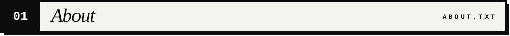
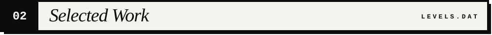
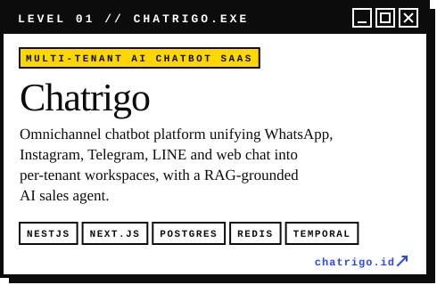
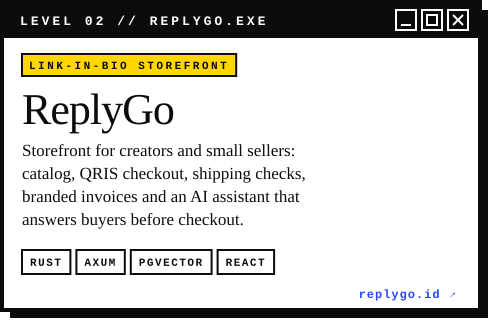
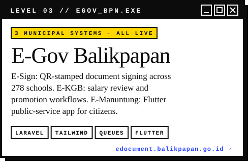
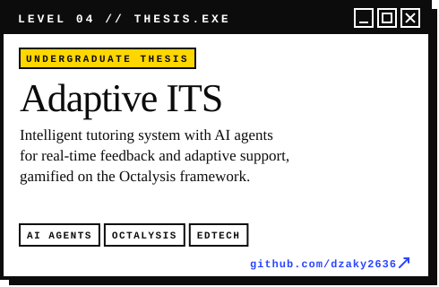
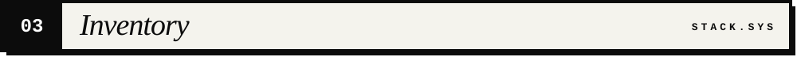
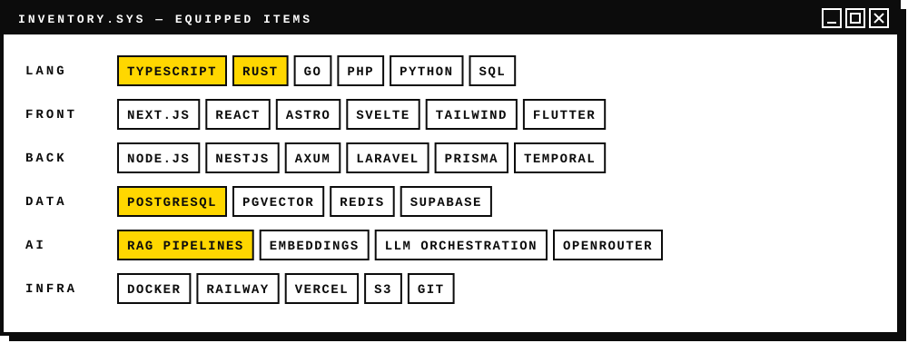

  

  
  
  
  

 

I build web systems end to end: interface, API, database, and the deployment that keeps them running. Most of my work is **TypeScript** and **Rust**, with a focus on multi-tenant SaaS and retrieval-augmented AI.

- **Architected** Chatrigo, a multi-tenant omnichannel chatbot platform, and ReplyGo, a Rust-backed storefront, at PT Rigo Inovasi Digital, where I led architecture and code review for a team of 8.
- **Shipped** three municipal e-government systems for Balikpapan. All are still live, one across 278 schools.
- **Taught** Machine Learning, Algorithms & Data Structures, and Web and Mobile Programming to 200+ students as a lab assistant at Universitas Multimedia Nusantara.
- **Studied** Computer Science at UMN, GPA 3.71.

 

  
  

  
  

 

  

 

